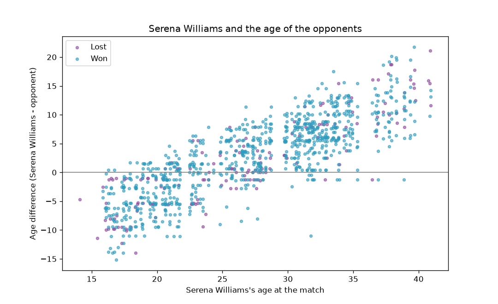
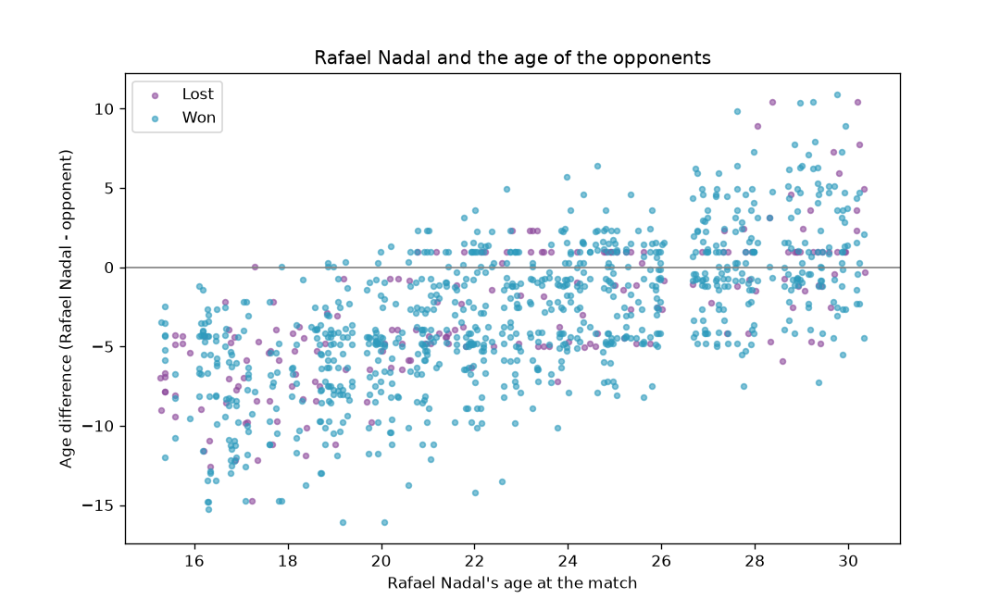

# HW3

Python package (`tennisage`) to get the career matches of a player from
[Tennis Abstract](https://www.tennisabstract.com) and make the age gap plot
from HW2 (without the annotations).




## Install

```bash
pip install git+https://github.com/UCB-stat159-f26/hw03-2-zhziszz.git
```

## How to use

```python
from tennisage import get_career_matches, plot_age_gap

serena = get_career_matches("serena williams")
plot_age_gap(serena)

rafa = get_career_matches("Rafael Nadal")
plot_age_gap(rafa)

# error, player not found
get_career_matches("GastonSanchez")
```

`get_career_matches()` gives a data frame like `serena` in HW2, one row per
match, with `age_player`, `age_opponent` and `age_gap` (player minus opponent).
The name can be "serena williams", "Serena Williams" or "SerenaWilliams".
`plot_age_gap()` returns the matplotlib figure.

## Data

The matches are from `jsmatches/<Name>Career.js` on Tennis Abstract. For women
the file has the opponent's birthday, for men it already has the opponent's
age. The player's own birthday is on the player page. Walkovers are dropped
like in HW2, and also the few matches with no opponent age.

Some career files are not up to date, e.g. Nadal's stops in 2016.

## Tests

```bash
pytest
```

The tests only use the small mock files in `tests/data/` (from the
instructions), nothing is downloaded.

## Files

```
src/tennisage/   data.py (get_career_matches) and plot.py (plot_age_gap)
tests/           tests and mock js files
images/          example plots
```
